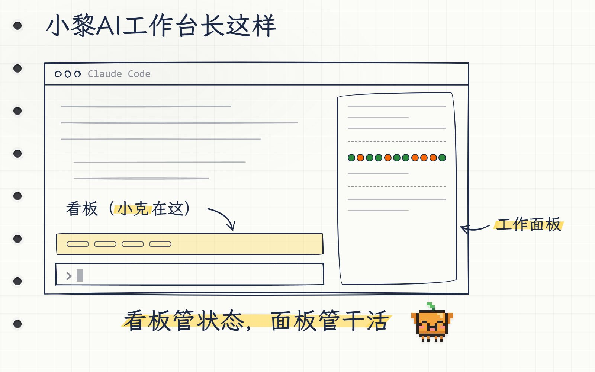
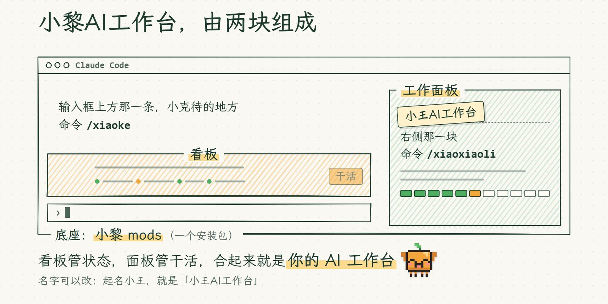
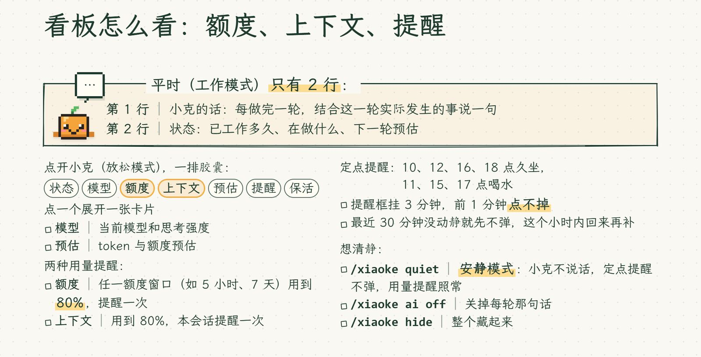
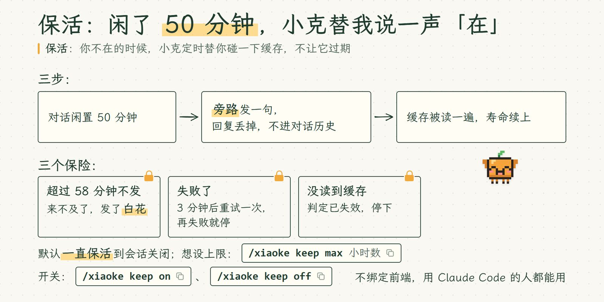
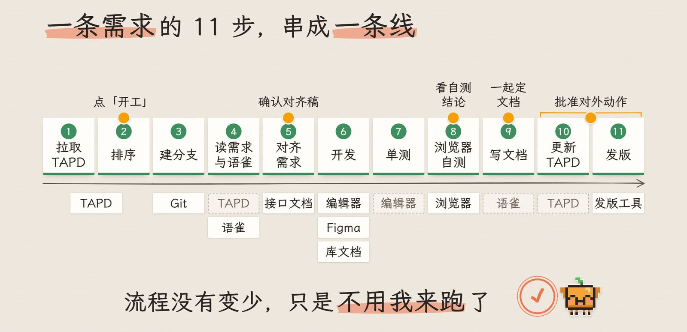
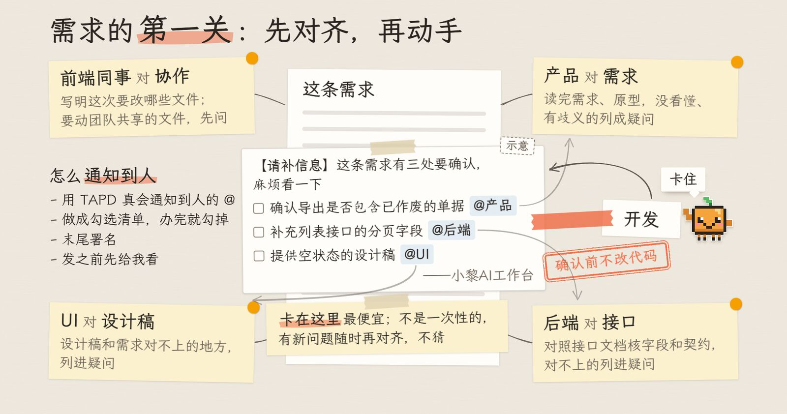
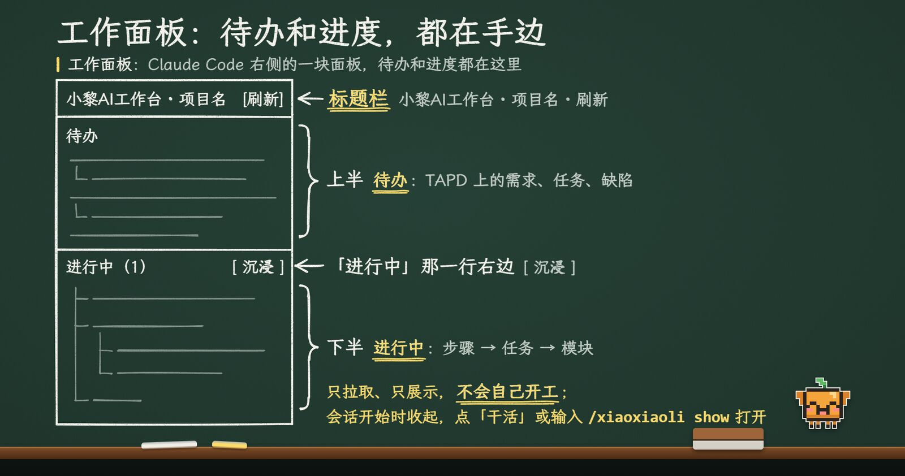
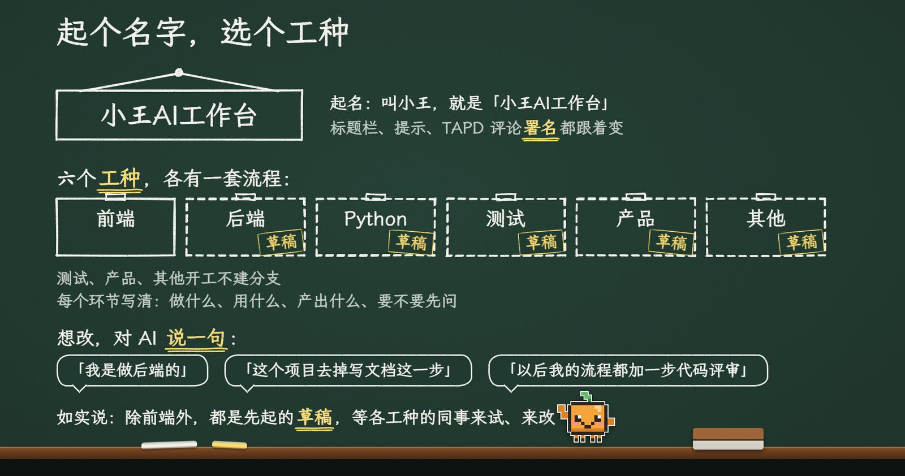
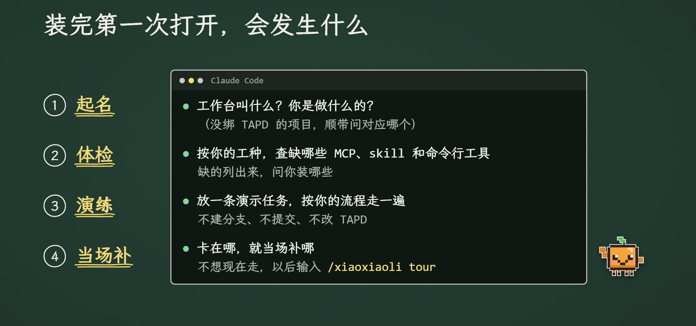

<h1 align="center">小黎 mods</h1>

<p align="center">
  装进 Claude Code 的一套 AI 工作台：<br>
  输入框上方一条<b>看板</b>，像素小方块<b>小克</b>趴在上面，显示模型、额度、上下文，到点提醒你起来走走；<br>
  右侧一块<b>工作面板</b>，拉出你的 TAPD 待办，点「开工」后按你工种的流程一步步推进，做到哪一步一眼能看到。
</p>

<p align="center">
  
  
</p>

一条命令装好：

```
claude plugin install xiaoke --marketplace xiaoli1999/xiaoli-mods
```

装好后重开 Claude Code，它会自己问你工作台叫什么、你做什么工种。

<p align="center">
  
</p>

---

## 目录

- [它长什么样](#它长什么样)
- [能做什么](#能做什么)
  - [看板上的小克](#看板上的小克)
  - [缓存保活](#缓存保活)
  - [一条需求，串成一条线](#一条需求串成一条线)
  - [工作面板](#工作面板)
  - [按工种的工作流](#按工种的工作流)
- [三步上手](#三步上手)
- [需要什么](#需要什么)
- [你的东西放在哪，它会不会乱动](#你的东西放在哪它会不会乱动)
- [更新](#更新)
- [不用 Claude Code 的同事](#不用-claude-code-的同事)
- [想了解更多 / 想改它](#想了解更多--想改它)

## 它长什么样

装好后，Claude Code 里多了两块东西，合起来叫「小黎AI工作台」。

<p align="center">
  
</p>

| 叫法 | 在哪 | 管什么 |
| --- | --- | --- |
| **看板** | 输入框上方那一条 | 显示状态：模型、额度、上下文、这一轮在做什么 |
| **小克** | 趴在看板上的像素小方块 | 每轮说一句话、到点提醒、替你给缓存保活；点它展开，按「干活」打开工作面板 |
| **工作面板** | 右侧那一块 | 管干活：TAPD 待办、开工、进度 |

名字可以改。起名「小王」，标题栏、提示和 TAPD 评论的署名就都变成「小王AI工作台」。

## 能做什么

### 看板上的小克

小克平时只占 2 行，不挡视线：第 1 行是它说的话，第 2 行是已工作多久、在做什么、下一轮预估。

<p align="center">
  
</p>

- **模型与额度**：点开小克，一排胶囊。点「模型」看当前模型和思考强度，点「额度」「上下文」「预估」看 token 与额度的预估。
- **用量提醒**：任一额度窗口（比如 5 小时、7 天）用到 80%，提醒一次；上下文用到 80%，本会话提醒一次。
- **每轮一句话**：每做完一轮，小克结合这一轮实际发生的事说一句（调一次 haiku）。不想要就 `/xiaoke ai off`。
- **久坐喝水**：10、12、16、18 点提醒起来走走，11、15、17 点提醒喝口水。提醒框挂 3 分钟；你最近 30 分钟没动静就先不弹，这个小时内回来再补。想清静就 `/xiaoke quiet`。

### 缓存保活

你去开个会，回来对话的缓存还在。

<p align="center">
  
</p>

主对话最后一次请求后 50 分钟还没有新请求，小克就旁路发一次请求（不进对话历史），把主对话的提示词缓存读一遍，续上它的寿命。

- 离上次请求已经超过 58 分钟（比如电脑睡过）就不发了，来不及保。
- 失败了 3 分钟后重试一次，再失败就停；读到的缓存不到这次输入的一半，判定缓存已失效，也停。
- 默认一直保活到会话关闭。每次保活花一次请求的 token（主要是读缓存），次数和用量在「保活」卡片里。不想花就 `/xiaoke keep off`，想设上限就 `/xiaoke keep max <小时>`。

### 一条需求，串成一条线

一条 TAPD 需求从拉待办到发版有 11 个环节，工作台把它们排成一条线，AI 按顺序走，到了需要你拍板的地方停下来等你。

<p align="center">
  
</p>

图上的橙点就是停下来等你的地方：

- **开工**：你在工作面板上点了「开工」才开始，它不会自己挑一条做。
- **对齐需求**：AI 先读正文、附件、图片、评论和需求里的语雀文档，写出需求摘要、疑问、方案、要改哪些文件，你确认之前不改代码。
- **看自测结论**：在受控浏览器里登录测试账号走一遍需求，把结论和截图给你看。
- **一起定文档**：先和你定提纲，内容由你定稿，上传语雀前给你预览。
- **批准对外动作**：推送代码、改别人的 TAPD 条目、发版这类动作先问你；生产环境的发版由你自己点。

缺陷走另一条 6 步的线：读截图、核环境版本、复现、定位判定、修复或拒绝、验证。根因和改法要你同意后才动代码。

对齐这一步最值得多花几分钟：需求、原型、设计稿、接口文档对不上的地方，都在这里列成疑问。

<p align="center">
  
</p>

疑问要找别人确认时，可以让 AI 发成 TAPD 评论。评论按约定写：要别人办的事写成可勾选清单，每项末尾 @ 到负责人（用 TAPD 真会通知到人的 @ 写法），对方办完点一下就勾掉；末尾署「——小黎AI工作台」。在别人的条目上发评论之前，先问你。

这条线上还有两处值得一提：

- **建分支时先学你的写法**：AI 先看你自己在这个仓库里建过的分支，归纳出你的命名习惯（有没有版本前缀、你的名字段是什么、需求 ID 放在哪），照着建；学不到就问你一次并记住。建之前会自检，不会建出缺一段的分支名。
- **发版和提测有工具可用**：用 Jenkins 发版的项目，插件自带一个发版工具。AI 先把将要触发的内容给你看，你同意才触发，然后等构建结束、做发版后验收；发到测试环境后按项目流程提测，并在条目上写明版本和测试重点。标为受保护的环境（比如生产）它不会触发，只能你自己操作。Jenkins 的地址、job 和账号要你配一次，配置方法见[工作面板的说明](mods/xiaoxiaoli/README.md)。

### 工作面板

工作面板上半是待办，下半是进行中。

<p align="center">
  
</p>

- **待办**：拉出你在 TAPD 上的需求、任务、缺陷，任务挂在所属需求下面，可以按迭代筛，也可以切到「全部项目」看。工作面板只拉取、只展示，不会自己开工。
- **开工**：点一行，出现「[ 开工 <ID> ]」，再点一下才开始。当前会话空着就在这里做；当前会话正忙或手上还有没做完的，就给你一条新会话的启动命令（git worktree 加新分支，一条需求一个目录、一个会话），已经复制好，到新终端粘贴运行。
- **进度**：进行中的条目按「步骤 → 任务 → 模块」展开成一棵树，AI 每走一步就更新一次；哪条在等你看对齐稿、看自测、批准改 TAPD，也标在上面。
- **沉浸**：点「进行中」那一行右边的「[ 沉浸 ]」，只留标题行和进行中的任务，再点一下回到原样。

会话开始时工作面板是收起的。点小克的「干活」，或输入 `/xiaoxiaoli show` 打开。

### 按工种的工作流

开工走哪套流程，看你是做什么的。

<p align="center">
  
</p>

内置六套：前端、后端、Python、测试、产品、其他。测试、产品、其他开工不建分支。每个环节都写清做什么、用什么、产出什么、要不要先问你。

> [!NOTE]
> 前端这套是作者日常在用的。其余五套是先起的草稿，还没有对应工种的同事实际用过，欢迎来试、来改。

想调整，直接对 AI 说一句：

- 「我是做后端的」：换工种（也可以 `/xiaoxiaoli role 后端`）。
- 「这个项目去掉写文档这一步」：只改这个项目。
- 「以后我的流程都加一步代码评审」：改你所有的项目。

改动存在你自己电脑的 `~/.claude/xiaoxiaoli` 下，不往项目仓库里写文件；已经在做的条目按开工时的步骤走，不受影响。

## 三步上手

<p align="center">
  
</p>

**1. 装**

```
claude plugin install xiaoke --marketplace xiaoli1999/xiaoli-mods
```

这条装的是小克 `xiaoke`。它依赖工作面板 `xiaoxiaoli`，所以工作面板会被一起装上，插件市场 `xiaoli-mods` 也会顺带登记。只想要工作面板、不要小克的，把命令里的 `xiaoke` 换成 `xiaoxiaoli`；小克不能单独装。

<details>
<summary>Claude Code 版本较旧，提示不认识 <code>--marketplace</code>？</summary>

分两条装，效果相同：

```
claude plugin marketplace add xiaoli1999/xiaoli-mods
claude plugin install xiaoke@xiaoli-mods
```

</details>

以前自己把工作流 skill 复制到 `~/.claude/skills/xiaoli-workflow` 的，装好后把那份删掉，免得两份不一致；skill 已经随工作面板一起装上了。

**2. 重开 Claude Code**

重开，或在会话里输入 `/reload-plugins`。第一次在交互式会话里打开时：

- 不用点也不用输命令，AI 会问你给工作台起什么名字（默认「小黎」）、你主要做哪类工作。这台机器只自动问这一次，不想设就选默认。
- 项目还没绑定 TAPD 的，顺带问对应哪个 TAPD 项目。
- 接着问要不要花几分钟走一遍演练：先体检本机缺哪些 MCP、skill 和命令行工具，缺的问你装哪些；再放一条演示条目，按你的流程模拟走一遍。演练不建分支、不提交、不改 TAPD，会多花几轮对话。以后想走就输入 `/xiaoxiaoli tour`。

**3. 点一条待办「开工」**

点小克的「干活」（或输入 `/xiaoxiaoli show`）打开工作面板，点一条待办，再点「[ 开工 <ID> ]」。

<details>
<summary>常用命令</summary>

| 命令 | 作用 |
| --- | --- |
| `/xiaoke` | 小克在工作模式（2 行）和放松模式（展开）之间切换 |
| `/xiaoke rest` | 休息 2 分钟 |
| `/xiaoke quiet` | 安静模式：小克不说话，定点提醒不弹 |
| `/xiaoke ai on`、`ai off` | 开关每轮结束时的那一句话 |
| `/xiaoke keep on`、`keep off` | 开关缓存保活 |
| `/xiaoke hide`、`show` | 把小克藏起来、叫出来 |
| `/xiaoxiaoli show`、`hide` | 打开、收起工作面板 |
| `/xiaoxiaoli refresh` | 立即刷新待办 |
| `/xiaoxiaoli setup` | 让 AI 引导你给工作台起名 |
| `/xiaoxiaoli name <名字>` | 直接改名，不经过 AI |
| `/xiaoxiaoli role <工种>` | 直接改工种，不经过 AI |
| `/xiaoxiaoli project` | 看本项目的配置概况 |
| `/xiaoxiaoli tour` | 再走一遍体检与演练 |
| `/xiaoxiaoli unbind` | 解除本项目的 TAPD 绑定 |

`xiaoxiaoli` 是工作面板这个插件的内部标识，沿用旧名；AI 用的工具叫 `mcp__xiaoxiaoli__*`。完整的命令见两个 mod 各自的说明。

</details>

## 需要什么

装完的演练会按你的工种体检，缺什么告诉你、问你要不要装，不用一次装齐。

| 依赖 | 必须吗 | 做什么用 |
| --- | --- | --- |
| Claude Code | 必须 | 工作台只在 Claude Code 里跑。一条命令的装法要 2.1.275 及以后，更旧的版本用分两条的装法 |
| TAPD MCP 服务器，名字必须是 `tapd` | 用待办和开工就要 | 拉待办、读需求与缺陷。会话里输入 `/mcp` 核对，工具名前缀应为 `mcp__tapd__`。它靠 uv 的 `uvx` 启动 |
| 语雀 skill `li-yuque-skills` | 建议装 | 读需求里的语雀文档与原型，上传分享文档 |
| chrome-devtools MCP | 可选 | 浏览器自测（前端、测试、产品用得到） |
| figma MCP | 可选 | 读设计稿（前端、产品用得到） |
| context7 MCP | 可选 | 查三方库的文档（前端、后端、Python 用得到） |
| git | 前端、后端、Python 要 | 建分支、提交 |
| Node.js、uv | 建议装 | 用 `npx`、`uvx` 安装和启动上面的 MCP 与 skill |

不用 TAPD 也能用一部分：

- 看板和小克（模型、额度、提醒、缓存保活）不依赖 TAPD，用 Claude Code 的人都能用。
- 对 AI 说「这个项目不用 TAPD」，工作面板就不再列 TAPD 项目、不拉待办；进行中区、进度和工作流照常。

## 你的东西放在哪，它会不会乱动

一句话：配置都在你自己电脑的全局目录里，不往项目仓库里写文件；动别人、动线上的事先问你。

**放在哪**

| 内容 | 位置 |
| --- | --- |
| 工作台名字、工种、演练记录 | `~/.claude/xiaoxiaoli/profile.json`，所有项目共用 |
| 上次体检的结果 | `~/.claude/xiaoxiaoli/env.json` |
| 项目与 TAPD 的绑定、进度 | `~/.claude/xiaoxiaoli/projects/<项目键>/` 下的 `config.json`、`state.json` |
| 资料与测试账号 | 各项目通用的放 `~/.claude/xiaoxiaoli/shared/`，只属于某个项目的放那个项目的目录；都是 `resources.md`、`secrets.env`，AI 用到时创建和维护 |
| TAPD 等 MCP 服务器的令牌 | 系统环境变量，在 MCP 配置里引用；不写进任何仓库 |

小克只写 Claude Code 给插件的存储，不写任何文件。两个 mod 都不读密钥文件；`secrets.env` 只给会话里的 AI 按流程读取使用。账号是明文存在本机的，只放测试环境的账号。

<details>
<summary>项目键、老项目怎么算</summary>

- 项目键是主工作区目录名加路径短哈希（如 `my-app-1a2b3c4d`），开工消息和绑定结果里有完整路径。项目搬了位置就是新键，要重新绑定一次。
- 自带配置的项目：项目里有 `docs/xiaoli/local/workbench/config.json` 的，照旧读项目内的，不看全局目录。
- 只有进度文件的老项目：项目里只有 `docs/xiaoli/local/workbench/state.json`、没有 `config.json` 的，绑定走全局目录，进度继续用项目内那份。

</details>

**先问你的事**

工作面板自己对 TAPD 只读：只调 `get_` 开头的查询工具，不改状态、不发评论、不建条目。改 TAPD、推代码这些事是会话里的 AI 按流程做的，流程里写明这些一定先问你：

- 改别人 TAPD 条目上的评论、状态或处理人；新建需求、任务、缺陷；缺陷的拒绝、转交、无法复现
- `git push`（并且绝不推 `master`、`main` 这类主干，合主干只走 MR）
- 上传语雀
- 后端的写操作（自测时只在约定的测试数据范围内做）
- 安装全局工具、MCP、skill
- 修改团队共享文件、删除目录

这些规则写在工作流 skill 里，由 AI 遵守。

**它自己会做的事**

- 不经你操作就往会话里发消息的只有一次：装好后第一次打开时的设置引导（会花一轮对话的 token）。演练只在你同意后才开始。
- 花 token 的地方：小克每轮那一句话和你点的「悄悄话」（haiku）、缓存保活、设置引导、演练。前两样分别用 `/xiaoke ai off`、`/xiaoke keep off` 关掉。
- 联网：每天检查一次更新（见下一节），只读 `raw.githubusercontent.com` 和 jsDelivr 镜像上本仓库的版本号与更新记录，不带任何用户或项目信息。TAPD 走你会话里已连接的 `tapd` MCP 服务器。

## 更新

每台机器上，每天第一次打开 Claude Code 时，两个 mod 各自看一眼 GitHub 上有没有新版，有就自己装好。

- 插件市场装的：等会话空闲，运行下面两条，再自动发起 `/reload-plugins` 让新版马上生效，并告诉你「已从 x 更新到 y」和更新了什么。

  ```
  claude plugin marketplace update xiaoli-mods
  claude plugin update <mod>@xiaoli-mods
  ```

- 失败时提示原因和手动命令，不影响继续用，下次开会话再试。
- 本地目录加载的（开发者自己的机器）：不改任何文件，只提示有新版，到仓库目录 `git pull`。
- 当天成功查过一次就不再查；`claude -p`、SDK 这类非交互式会话不查。不提供关闭开关。

## 不用 Claude Code 的同事

工作流本身是一份 Markdown skill，Codex 等别的 AI 工具也能用：把 [`mods/xiaoxiaoli/skills/xiaoli-workflow`](mods/xiaoxiaoli/skills/xiaoli-workflow) 整个目录复制到那个工具的 skills 目录，比如 Codex 放到 `~/.agents/skills/xiaoli-workflow`。里面提到的 `mcp__xiaoxiaoli__*` 工具只有装了工作面板才有，没有时按正文的通用规则走。

语雀 skill 是单独的仓库 [xiaoli1999/li-yuque-skills](https://github.com/xiaoli1999/li-yuque-skills)，工作流里读需求的语雀文档与原型、上传分享文档用的就是它，也可以单独装来用。

## 想了解更多 / 想改它

- 小克的完整说明：[mods/xiaoke/README.md](mods/xiaoke/README.md)，更新记录 [mods/xiaoke/CHANGELOG.md](mods/xiaoke/CHANGELOG.md)
- 工作面板的完整说明（工作流定义、体检与演练、配置与状态文件、已知限制）：[mods/xiaoxiaoli/README.md](mods/xiaoxiaoli/README.md)，更新记录 [mods/xiaoxiaoli/CHANGELOG.md](mods/xiaoxiaoli/CHANGELOG.md)

<details>
<summary>仓库里有什么</summary>

| 目录 | 是什么 |
| --- | --- |
| `mods/xiaoke` | 小克（`xiaoke` 既是它的名字，也是插件标识）：看板、缓存保活、模型与额度、定点提醒；「干活 / 收工」开关工作面板 |
| `mods/xiaoxiaoli` | 工作面板：TAPD 待办、开工、进度；六个工种的内置工作流在 `workflows/`，体检清单与演练脚本在 `guide/` |
| `mods/xiaoxiaoli/skills/xiaoli-workflow` | 通用开发流程 skill：需求各环节、缺陷 6 步、必须先问的动作与 Git 规则。随工作面板一起装，会话里叫 `xiaoxiaoli:xiaoli-workflow` |
| `.claude-plugin/marketplace.json` | 插件市场清单：市场名 `xiaoli-mods`，列出上面两个 mod |

</details>

<details>
<summary>开发者：本地加载与跑测试</summary>

克隆仓库（下面写作 `<仓库>`），把两个 mod 目录追加到环境变量 `CLAUDE_CODE_PLUGIN_DIRS`（系统环境变量，或 `~/.claude/settings.json` 的 `env`），Windows 用 `;` 分隔，然后重开 Claude Code：

```
CLAUDE_CODE_PLUGIN_DIRS=<仓库>\mods\xiaoke;<仓库>\mods\xiaoxiaoli
```

- 这样加载时 mod 文件一改就热重载，没生效就输入 `/reload-plugins` 或重开会话；自动更新只提示，更新靠 `git pull`。
- 同名的 mod 只留一份：本地目录加载的会顶替插件市场装的同名插件，两边都装容易弄不清用的是哪份；以前装在 `~/.claude/mods/xiaoxiaoli` 之类位置的，把那一项换成本仓库的。

跑测试与校验：

```
claude plugin test <仓库>\mods\xiaoxiaoli
claude plugin test <仓库>\mods\xiaoke
claude plugin validate <仓库>
```

</details>

<details>
<summary>发版</summary>

两个 mod 各自按版本号发：改 `mods/<mod>/.claude-plugin/plugin.json` 的 `version`，在 `mods/<mod>/CHANGELOG.md` 顶部加一节 `## <版本号>`，写几条更新要点，合进主分支 `master`。只有版本号变了才算新版：同事的 Claude Code 下一天第一次打开时自动装上（插件市场的规则也是 `version` 不变就不更新）。

</details>

## 许可证

[MIT](LICENSE)

<sub>本页配图是手绘示意，不是真实界面截图。</sub>
